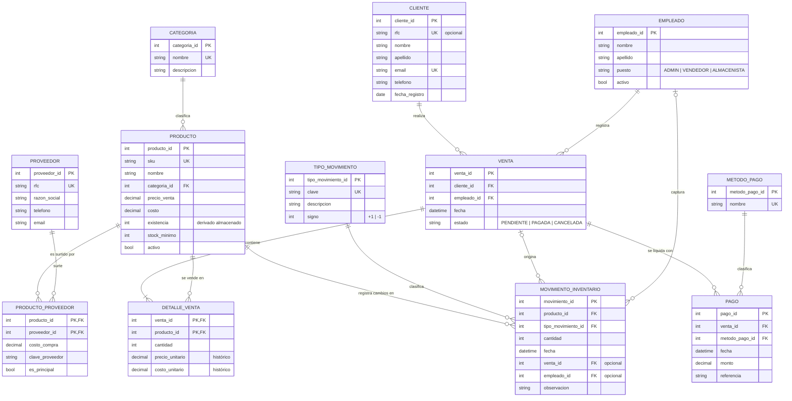

# Fase 2 · Modelo conceptual (Entidad-Relación)

**Proyecto integrador — Equipo 5 · Sistema de ventas e inventarios**

Este modelo parte del análisis ([02_analisis.md](02_analisis.md)). Cada entidad y relación cita las
reglas de negocio (RN) que representa. Los tipos de dato exactos y las restricciones físicas se
definen en la Fase 3.

---

## 1. Diagrama ER

> El diagrama está en Mermaid. Se ve directamente en GitHub o en VS Code con la extensión
> *Markdown Preview Mermaid Support*. Para el reporte se puede exportar a imagen desde
> <https://mermaid.live>.

Notación de cardinalidad (pata de gallo):

| Símbolo | Significado |
|---|---|
| `\|\|` | exactamente uno |
| `\|o` | cero o uno |
| `\|{` | uno o muchos |
| `o{` | cero o muchos |



**Atributo derivado no almacenado:** el *total* de `VENTA` = `Σ cantidad × precio_unitario` de sus
renglones (RN-10). Se muestra aquí como concepto, pero no es una columna: se calcula con
`fn_total_venta` y `v_venta_saldos`.

---

## 2. Entidades y justificación

**12 entidades:** 8 principales, 2 catálogos y 2 asociativas.

| Entidad | Tipo | Identificador | Por qué existe |
|---|---|---|---|
| CATEGORIA | Principal | `categoria_id` | Agrupa productos y evita repetir el nombre de la categoría en cada producto (RN-01). Base del reporte por categoría (consulta 10). |
| PRODUCTO | Principal | `producto_id` (SKU como clave alterna) | Artículo que se vende y se almacena. Guarda precio y costo **vigentes**, stock mínimo y saldo (RN-03, RN-05, RN-16). |
| PROVEEDOR | Principal | `proveedor_id` (RFC como clave alterna) | Empresas que surten mercancía (RF-03). |
| CLIENTE | Principal | `cliente_id` | Comprador. Incluye el registro "PÚBLICO EN GENERAL" para ventas de mostrador (RN-06). |
| EMPLEADO | Principal (agregada por el equipo) | `empleado_id` | Responde "¿quién registró esta venta o este movimiento?". Representa a los actores internos (RN-22). |
| VENTA | Principal | `venta_id` | Cabecera de la transacción: cliente, empleado, fecha y estado (RN-06, RN-12). |
| PAGO | Principal | `pago_id` | Cada abono a una venta. Hace posibles los pagos parciales (RN-13, RN-14). |
| MOVIMIENTO_INVENTARIO | Principal | `movimiento_id` | Historial inmutable de entradas y salidas. Es la **fuente de verdad** del inventario (RN-15, RN-17, RN-19). |
| METODO_PAGO | Catálogo (agregada) | `metodo_pago_id` | Valores controlados (efectivo, tarjeta, transferencia…) en lugar de texto libre. Permite agregar métodos sin cambiar la estructura. |
| TIPO_MOVIMIENTO | Catálogo (agregada) | `tipo_movimiento_id` | Además del nombre guarda el **signo** (+1/−1) que define el sentido del movimiento. Por ese atributo es una entidad y no un `ENUM` (RN-15). |
| PRODUCTO_PROVEEDOR | Asociativa | (`producto_id`, `proveedor_id`) | Resuelve la relación N:M producto–proveedor y guarda atributos propios de la relación: costo de compra, clave del proveedor y proveedor principal (RN-04). |
| DETALLE_VENTA | Asociativa | (`venta_id`, `producto_id`) | Resuelve la relación N:M venta–producto. Guarda cantidad, precio y costo **aplicados en esa venta** (RN-07–RN-09). |

**Entidad descartada:** *Orden de compra*. Las compras se registran como movimientos `ENTRADA`, y el
ciclo de compras queda fuera del alcance (ver el análisis, sección 3).

---

## 3. Relaciones, cardinalidad y participación

La participación se lee "mínimo..máximo" desde cada lado. **Total** quiere decir que la entidad no
puede existir sin la relación; **parcial**, que sí puede.

| # | Relación | Tipo | Lado "uno" | Lado "muchos" | Regla | Lectura |
|---|---|---|---|---|---|---|
| R1 | Categoría – Producto | 1:N | Un producto tiene **1..1** categoría (total) | Una categoría tiene **0..N** productos (parcial) | RN-01 | Se puede crear una categoría antes de sus productos. |
| R2 | Cliente – Venta | 1:N | Una venta tiene **1..1** cliente (total) | Un cliente tiene **0..N** ventas | RN-06 | Un cliente recién registrado no tiene compras. |
| R3 | Empleado – Venta | 1:N | Una venta la registra **1..1** empleado (total) | Un empleado registra **0..N** ventas | RN-06 | Un almacenista nunca registra ventas. |
| R4 | Venta – Pago | 1:N | Un pago pertenece a **1..1** venta (total) | Una venta tiene **0..N** pagos | RN-13 | Una venta `PENDIENTE` puede no tener pagos. |
| R5 | Método_Pago – Pago | 1:N | Un pago usa **1..1** método | Un método aparece en **0..N** pagos | RN-13 | — |
| R6 | Producto – Movimiento | 1:N | Un movimiento afecta **1..1** producto (total) | Un producto tiene **0..N** movimientos | RN-15 | Un producto recién dado de alta no tiene movimientos. |
| R7 | Tipo_Movimiento – Movimiento | 1:N | Un movimiento tiene **1..1** tipo | Un tipo aparece en **0..N** movimientos | RN-15 | — |
| R8 | Venta – Movimiento | 1:N | Un movimiento se origina en **0..1** venta (parcial) | Una venta origina **0..N** movimientos | RN-18 | Solo las salidas por venta y las devoluciones tienen venta; las entradas y los ajustes no. |
| R9 | Empleado – Movimiento | 1:N | Un movimiento lo captura **0..1** empleado (parcial) | Un empleado captura **0..N** movimientos | — | Las salidas automáticas por venta no tienen capturista; quien vendió ya está en `VENTA`. |
| R10 | Producto – Proveedor | **N:M** | Un producto tiene **0..N** proveedores | Un proveedor surte **0..N** productos | RN-04 | Se resuelve con `PRODUCTO_PROVEEDOR`. |
| R11 | Venta – Producto | **N:M** | Una venta contiene **1..N** productos (total) | Un producto aparece en **0..N** ventas | RN-07 | Se resuelve con `DETALLE_VENTA`. El 0..N del producto es la base de la consulta 8 ("productos sin ventas"). |

### Cómo se resuelven las relaciones N:M

Cada N:M se convierte en una **entidad asociativa** con dos relaciones 1:N:

```
PRODUCTO 1 ──< PRODUCTO_PROVEEDOR >── 1 PROVEEDOR
VENTA    1 ──< DETALLE_VENTA      >── 1 PRODUCTO
```

- El identificador de cada asociativa es la **combinación** de los dos identificadores. Esto
  garantiza que un mismo par no se repita: un proveedor no se asocia dos veces al mismo producto y un
  producto no aparece en dos renglones de la misma venta (RN-04, RN-07).
- Las asociativas no son solo enlaces: tienen **atributos propios de la relación**. `costo_compra`
  depende del par producto–proveedor y no de uno solo. `cantidad` y `precio_unitario` dependen del par
  venta–producto.

### Por qué cada cardinalidad es la que es

- **1:N y no N:M en Categoría–Producto:** la regla del escenario dice que *cada producto pertenece
  a una categoría*.
- **N:M en Producto–Proveedor:** el escenario lo permite explícitamente y es el caso real, porque un
  mismo tornillo lo surten varios distribuidores.
- **N:M en Venta–Producto:** una venta lleva varios productos y un producto se vende en muchas ventas.
- **1:N en Venta–Pago:** los pagos parciales exigen varios pagos por venta, y cada pago abona a una
  sola venta.
- **Participación total de Venta en Detalle (1..N):** una venta sin renglones no tiene sentido
  (RN-07). En el modelo físico no se puede declarar, así que la garantiza el procedimiento
  `registrar_venta` (ver la Fase 5).

---

## 4. Atributos con tratamiento especial

| Atributo | Clasificación | Decisión |
|---|---|---|
| `VENTA.total` | Derivado | **No se almacena** (RN-10). Se calcula del detalle. |
| `PRODUCTO.existencia` | Derivado **almacenado** | Se guarda por rendimiento, pero lo mantiene un trigger a partir de los movimientos, y la vista de conciliación lo verifica (RN-19). La justificación formal está en la Fase 4. |
| `DETALLE_VENTA.precio_unitario`, `costo_unitario` | Históricos | Se copian del catálogo en el momento de la venta. **No** son redundantes con `PRODUCTO.precio_venta` y `costo`, porque representan otro hecho: el precio pactado en esa transacción (RN-09). |
| `PRODUCTO.sku`, `PROVEEDOR.rfc` | Claves alternas | Identificadores de negocio únicos. Como PK se usa un entero sustituto para que las FK sean cortas y estables. |
| `CLIENTE.rfc` | Clave alterna opcional | No todos los clientes facturan. Es único cuando existe. |

---

## 5. Verificación de mínimos

| Requisito | Mínimo | Modelo | Estado |
|---|---|---|---|
| Entidades principales | 6 | 8 principales (+2 catálogos, +2 asociativas = 12) | ✅ |
| Relaciones en total | 6 | 11 | ✅ |
| Relaciones 1:N | 3 | 9 | ✅ |
| Relaciones N:M con tabla asociativa | 2 | 2 (`PRODUCTO_PROVEEDOR`, `DETALLE_VENTA`) | ✅ |
| Relaciones sugeridas por el escenario | 6 | Las 6 están (R1, R10, R2, R11, R4, R6) | ✅ |
| Cardinalidad y participación explícitas | — | Sección 3 | ✅ |

---

## 6. Ajuste respecto al plan

- **R1 Categoría–Producto:** el plan corregido decía 1..N del lado de la categoría. Se cambió a
  **0..N (parcial)**, porque una categoría se da de alta antes que sus productos. El paso 1 de la
  demostración (registrar el catálogo) lo necesita así.
